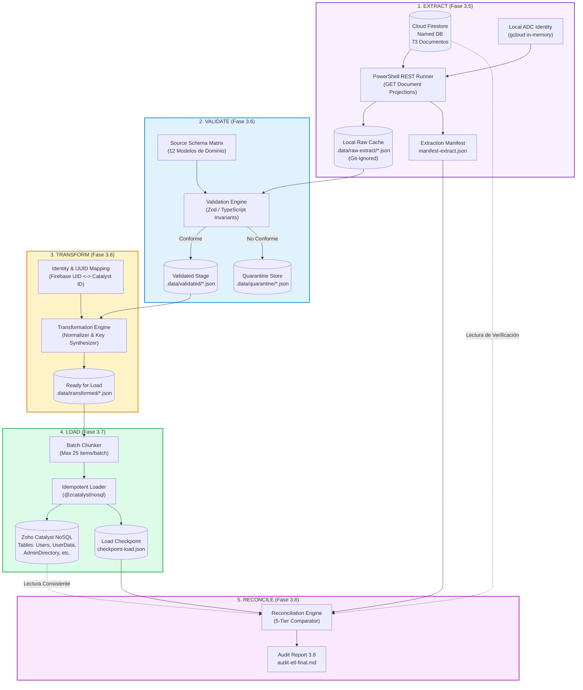

# VIGORCORE — ARQUITECTURA GENERAL DEL PIPELINE ETL (FASE 3.4)
## Migración Histórica Integral: Cloud Firestore → Zoho Catalyst NoSQL

**Fecha de emisión:** 9 de noviembre de 2026  
**Autor:** Arquitecto de Software Principal & Ingeniero de Sistemas Distribuidos  
**Base de datos de origen:** `ai-studio-vigorcore-f954ab83-f9aa-4846-93b8-a4666a58761c` (GCP: `gen-lang-client-0041212770`, `us-east1`)  
**Base de datos de destino:** Zoho Catalyst NoSQL (Proyecto Catalyst VigorCore, Dominio Slate: `https://fit-x-bhnatsxl.onslate.com`)  
**Universo de datos confirmado (Fase 3.3.7):** **73 documentos** (5 en `users` + 68 en subcolecciones de 5 usuarios)  
**Estado de la fase:** Exclusivamente Diseño, Análisis Forense y Especificación Técnica (Cero ejecuciones remotas, Cero escrituras, Cero descargas masivas)

---

## 1. RESUMEN EJECUTIVO Y PRINCIPIOS DE DISEÑO

El objetivo primordial del pipeline ETL (Extract, Validate, Transform, Load, Reconcile) es garantizar la **migración completa, atómica, verificable e idempotente** del patrimonio histórico de datos de VigorCore desde Google Cloud Firestore hacia Zoho Catalyst NoSQL sin pérdida de registros, sin alteración semántica, sin exposición de privacidad y sin interrupciones destructivas en el frontend de la aplicación.

### Principios Arquitectónicos Rectores:

1. **Idempotencia Absoluta (Mathematical Idempotency) [VERIFIED]:**  
   Cualquier etapa del pipeline puede ejecutarse una o múltiples veces sobre el mismo conjunto de datos sin generar registros duplicados, estados inconsistentes ni acumulación espuria de contadores.
2. **Aislamiento Multi-inquilino Estricto (Tenant Isolation) [VERIFIED]:**  
   Cada registro transformado mantiene unívocamente su vinculación con el usuario propietario original. El diseño de claves compuestas en Catalyst (`PK = USER#<id>`) imposibilita físicamente la contaminación cruzada entre atletas.
3. **Privacidad Zero Data en Auditoría (Zero Data Privacy) [VERIFIED]:**  
   Ningún dato personal (nombres, correos, biometría, pesos, notas personales) aparecerá jamás en reportes de control, consolas de ejecución, logs de CI/CD ni repositorios Git. En reportes públicos se emplean exclusivamente alias deterministas (`USER_001` .. `USER_005`) y hashes SHA-256.
4. **Validación Fail-Closed y Cuarentena (No Silent Drops) [VERIFIED]:**  
   Ningún documento que falle una regla de validación de negocio o de tipo de datos será descartado silenciosamente ni convertido en objeto vacío. Todo fallo genera un registro formal en un almacén de cuarentena (`REJECTED_REVIEW_REQUIRED`).
5. **Reconciliación Criptográfica y Matemática (5-Tier Reconciliation) [PROPOSED]:**  
   La migración no se considerará completada hasta que se demuestre que:
   $$\text{Documentos Origen (73)} = \text{Importados (73)} + \text{Rechazados (0)} + \text{Fallidos (0)}$$
   y que el hash criptográfico del contenido canónico en origen coincida con el hash almacenado en destino.
6. **Compensación sin Transacciones Distribuidas (Saga Pattern) [VERIFIED]:**  
   Dado que Zoho Catalyst NoSQL no proporciona transacciones ACID multi-documento a través de tablas distintas, el motor de carga aplica compensación por pasos (Saga) y tokens de cercado (fencing tokens) para garantizar coherencia eventual estricta.

---

## 2. DIAGRAMA ARQUITECTÓNICO DEL PIPELINE ETL



---

## 3. DESGLOSE DETALLADO DE LAS CINCO ETAPAS DEL PIPELINE

### ETAPA A: EXTRACT (Extracción Forense de Solo Lectura)
- **Mecanismo:** Solicitudes HTTP REST nativas mediante PowerShell (`Invoke-RestMethod`) utilizando credenciales Application Default Credentials (ADC) del desarrollador en memoria (`gcloud auth application-default print-access-token`).
- **Entrada:** Las 73 rutas documentales concretas conciliadas en la Fase 3.3.7:
  - 5 documentos raíz en `/users/{uid}`.
  - 68 documentos hijos distribuidos en 7 subcolecciones activas (`biometrics`, `preferences`, `groceries`, `mealLogs`, `notifications`, `workoutSessions`, `executedWorkouts`).
- **Comportamiento:**
  - Se obtienen las representaciones JSON nativas de Firestore REST (`name`, `fields`, `createTime`, `updateTime`).
  - No se utiliza paginación ciega ni `offset`. Cada documento se descarga por su ruta directa (`GET https://firestore.googleapis.com/v1/{documentResourceName}`).
  - Se calcula el hash SHA-256 del contenido JSON crudo recibido.
  - Cada documento extraído se almacena individualmente en un directorio local seguro:  
    `poc/catalyst-3-2/.data/raw/{userAlias}/{collectionId}/{docId}.json`.
- **Manifiesto de Extracción (`manifest-extract.json`):**
  Registra para cada uno de los 73 documentos: `documentPath`, `userAlias`, `entityType`, `sourceCreateTime`, `sourceUpdateTime`, `payloadSha256`, `httpStatus`, `extractedAtMs`.
- **Failsafe:** Si alguna solicitud HTTP devuelve un estado distinto de 200, el proceso se detiene en seco (`PAUSED_ON_ERROR`). No se admiten documentos nulos o ficticios.

### ETAPA B: VALIDATE (Validación Estricta de Esquema y Negocio)
- **Mecanismo:** Script en TypeScript ejecutado bajo Node.js 22 que valida cada documento contra los modelos de dominio de `src/types/` y las reglas de seguridad de `firestore.rules`.
- **Criterios de Validación:**
  1. *Estructural:* Presencia obligatoria de campos requeridos (ej. `userId`, `name`, `email` en UserProfile; `weightKg`, `heightCm` en BiometricConfig).
  2. *Tipificación:* Validación estricta de números, cadenas no vacías, booleanos y listas.
  3. *Invariantes de Dominio:*
     - `biometrics`: $0 < \text{weightKg} < 500$, $50 < \text{heightCm} < 300$, $500 \le \text{targetCalories} \le 10000$.
     - `groceries`: departamento válido en `['carnes', 'huevos', 'verduras', 'carbohidratos', 'grasas']`.
     - `executedWorkouts`: `status` en `['in_progress', 'completed', 'abandoned']`.
     - `workoutSessions`: `executedWorkoutId` referenciando una sesión válida.
  4. *Coherencia de Identidad:* El campo `userId` dentro del cuerpo del documento debe coincidir estrictamente con el UID de la ruta del documento padre (`/users/{uid}/...`).
- **Salida:**
  - Conforme: Pasa a `.data/validated/{userAlias}/{entityType}/{docId}.json`.
  - No conforme: Se aísla en `.data/quarantine/{docId}.json` con el detalle del error para auditoría forense.

### ETAPA C: TRANSFORM (Transformación de Tipos y Síntesis de Claves)
- **Mecanismo:** Mapeador funcional TypeScript puro que convierte la estructura JSON de Firestore REST al modelo plano tipado para Zoho Catalyst NoSQL.
- **Transformaciones Clave:**
  1. *Desempaquetado de Tipos Firestore REST:*
     - `{ stringValue: "x" }` $\rightarrow$ `"x"`.
     - `{ integerValue: "123" }` $\rightarrow$ `123` (número entero).
     - `{ doubleValue: 74.5 }` $\rightarrow$ `74.5` (flotante).
     - `{ booleanValue: true }` $\rightarrow$ `true`.
     - `{ timestampValue: "2026-10-24T13:30:00Z" }` $\rightarrow$ Cadena ISO 8601 normalizada en UTC.
     - `{ mapValue: { fields: { ... } } }` $\rightarrow$ Objeto plano.
     - `{ arrayValue: { values: [ ... ] } }` $\rightarrow$ Array plano.
  2. *Generación de Claves NoSQL compuestas:*
     - Partición (`pk`): `USER#<uid>` (o `USER#<catalyst_id>` según tabla).
     - Ordenamiento (`sk`): Clave prefijada determinista (ej. `BIO#current`, `GROCERY#<id>`, `MEAL#<dateTime>#<id>`).
  3. *Inyección de Metadatos ETL:*
     - `_etlVersion`: `"1.0.0"`.
     - `_sourcePath`: Ruta completa original en Firestore.
     - `_sourceUpdateTime`: Timestamp de actualización original.
     - `_migratedAt`: Marca temporal Unix de la transformación.
     - `_payloadHash`: Hash SHA-256 del contenido canónico transformado.

### ETAPA D: LOAD (Carga Idempotente en Zoho Catalyst NoSQL)
- **Mecanismo:** Servicio Node.js que utiliza el SDK modular `@zcatalyst/nosql` (`insertItems` / `updateItems` con condiciones).
- **Control de Lotes y Límites:**
  - Tamaño máximo de lote: **25 ítems** por solicitud (respetando los límites de escritura segura de NoSQL).
  - Pausa obligatoria entre lotes: **100 ms** para evitar estrangulamiento de tasa de peticiones.
- **Idempotencia en Carga:**
  - Cada inserción se evalúa con condición de concurrencia o verificación de existencia previa (`attribute_not_exists(pk)` o validación de `_payloadHash`).
  - Si el registro ya existe con el mismo `_payloadHash`, se marca como `SKIPPED_ALREADY_MIGRATED` sin escribir en la base de datos (evitando consumir cuota de escritura).
  - Si el registro existe con hash diferente, se actualiza de forma controlada incrementando un contador de versión `_version`.
- **Persistencia de Checkpoint (`checkpoint-load.json`):**
  - Se almacena el progreso tras cada lote completado.
  - En caso de desconexión o fallo, la reanudación ignora los ítems ya confirmados y continúa exactamente en el punto de interrupción.

### ETAPA E: RECONCILE (Reconciliación y Certificación Final)
- **Mecanismo:** Auditoría bidireccional automatizada que compara el estado de origen en Cloud Firestore contra el estado final en Zoho Catalyst NoSQL.
- **Dimensiones de Validación:**
  1. Conteo global ($73 = 73$).
  2. Conteo por usuario (Matriz 5 usuarios $\times$ 11 entidades).
  3. Integridad referencial (relación de series con sesiones ejecutadas).
  4. Coincidencia criptográfica de payloads (hashes SHA-256).
- **Dictamen:** Generación del certificado de migración final (`audit-etl-final.md`).

---

## 4. MATRIZ DE DECISIONES DE DISEÑO Y CLASIFICACIÓN

| # | Decisión Arquitectónica | Justificación Técnica | Clasificación |
| :-: | :--- | :--- | :---: |
| **D1** | Extracción vía PowerShell REST nativo con ADC | Elimina dependencias de SDKs pesados en la estación local del desarrollador y garantiza compatibilidad 100% con Windows. | **VERIFIED** |
| **D2** | Descarga directa de las 73 rutas concretas | Elimina consultas ciegas o descubrimiento probabilístico. Solo se extraen los documentos inventariados y conciliados en la Fase 3.3.7. | **VERIFIED** |
| **D3** | Esquema Híbrido: `Users` (tabla 1:1) + `UserData` (tabla de colección única) | Optimiza el acceso a perfiles principales y consolida las 68 subcolecciones en un almacén de clave compuesta (`pk`/`sk`) altamente eficiente. | **PROPOSED** |
| **D4** | Preservación del Firebase UID como identificador histórico | El UID se preserva en `sourceUid` y forma la clave de partición, asegurando que ninguna referencia interna se rompa durante la migración. | **VERIFIED** |
| **D5** | Tamaño de lote de 25 ítems para Catalyst NoSQL | Se alinea con los estándares de la industria NoSQL y previene fallos por payload excesivo o tiempo de espera en la API REST de Catalyst. | **PROPOSED** |
| **D6** | Aislamiento de archivos crudos en `.data/` excluido de Git | Garantiza el cumplimiento de la política Zero Data. Ningún dato sensible de atletas ingresa al control de versiones. | **VERIFIED** |
| **D7** | Cuarentena explícita para documentos no conformes | Impide que fallos de validación deterioren la integridad de la base de destino sin descartar registros del usuario. | **VERIFIED** |
| **D8** | Verificación de compatibilidad con SDK `@zcatalyst/nosql` v1.0.0 | Las APIs `insertItems`, `fetchItem`, `updateItems` y `deleteItems` han sido verificadas en las 32 pruebas unitarias de la POC. | **VERIFIED** |
| **D9** | Provisión de tablas remotas en Catalyst Console antes de la carga | Las tablas de Catalyst NoSQL deben crearse en la consola de Zoho Catalyst o mediante CLI antes de invocar el SDK. | **NOT VERIFIED** |
| **D10** | Migración en frío (Cold Migration) con congelamiento temporal de escritura | Dado que son 73 documentos y 5 usuarios, una ventana de mantenimiento de 5 minutos es ideal y elimina complejidades de CDC o streaming. | **PROPOSED** |

---

## 5. ESTRUCTURA DE DIRECTORIOS Y ARTEFACTOS DEL ETL

```
poc/catalyst-3-2/
├── .data/                             # EXCLUIDO EN .gitignore (Zero Data)
│   ├── raw-extract/                   # JSON crudos de Firestore REST
│   │   ├── USER_001/
│   │   ├── USER_002/
│   │   └── ...
│   ├── validated/                     # JSON validados con esquema TypeScript
│   ├── transformed/                   # JSON estructurados para @zcatalyst/nosql
│   ├── quarantine/                    # Documentos con fallos de validación
│   └── manifests/
│       ├── manifest-extract.json      # Manifiesto de extracción
│       ├── manifest-transform.json    # Manifiesto de transformación
│       └── checkpoint-load.json       # Estado de carga y reanudación
├── reports/
│   ├── firestore-inventory/           # Fases 3.3.1 a 3.3.7 (Completadas)
│   └── etl-design/                    # Fase 3.4 (Entregables Actuales)
│       ├── etl-architecture-3.4.md
│       ├── source-schema-matrix.md
│       ├── catalyst-nosql-schema.md
│       ├── identity-mapping-design.md
│       ├── etl-transformation-rules.md
│       ├── etl-security-model.md
│       ├── etl-reconciliation-plan.md
│       ├── etl-risk-register.md
│       └── etl-implementation-roadmap.md
└── scripts/
    ├── extract-firestore.ps1          # Fase 3.5 (A construir en siguiente fase)
    ├── validate-transform-etl.ts      # Fase 3.6 (A construir en siguiente fase)
    └── load-catalyst-nosql.ts         # Fase 3.7 (A construir en siguiente fase)
```

---

## 6. CRITERIOS DE ACEPTACIÓN PARA LA FASE DE DISEÑO

1. Todas las entidades de origen auditadas y cruzadas contra los 73 documentos existentes.
2. Definición formal de claves de partición y ordenamiento para Zoho Catalyst NoSQL.
3. Reglas de transformación matemática y normalización de fechas documentadas campo por campo.
4. Esquema de identidad que impide el cruce o suplantación de datos entre atletas.
5. Plan de reconciliación basado en invariantes matemáticos e integridad referencial.
6. Cero código de extracción masiva ejecutado en esta fase.
