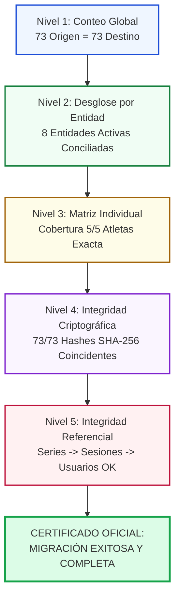

# VIGORCORE — PLAN DE RECONCILIACIÓN MATEMÁTICA Y CRIPTOGRÁFICA (FASE 3.4)
## Marco de Verificación de 5 Niveles, Estados Terminales y Certificación de Integridad

**Fecha de emisión:** 9 de noviembre de 2026  
**Auditor:** Auditor Forense de Sistemas & Ingeniero de Confiabilidad de Datos  
**Universo Objetivo:** 73 Documentos (5 en `users` + 68 en subcolecciones)

---

## 1. MARCO DE AUDITORÍA EN 5 NIVELES (5-TIER VERIFICATION MODEL)

Para certificar sin margen de duda que ningún registro se ha extraviado, corrompido ni transformado de forma espuria, el proceso de reconciliación post-carga ejecuta cinco comprobaciones independientes:

---

### NIVEL 1: RECONCILIACIÓN DE VOLUMEN TOTAL (TOTAL VOLUME CHECK)
- **Invariante Matemático:**  
  $$\sum \text{Documentos en Firestore} = \sum \text{Registros en Catalyst NoSQL}$$
  $$73 \text{ documentos en origen} = 5 \text{ (en } Users) + 68 \text{ (en } UserData)$$
- **Criterio de Aprobación:** Coincidencia exacta al 100%. Si la suma difiere en una sola unidad ($72$ o $74$), la reconciliación se dictamina automáticamente como **FAILED**.

---

### NIVEL 2: RECONCILIACIÓN POR TIPO DE ENTIDAD (ENTITY BREAKDOWN CHECK)
Cada tipo de documento debe coincidir unívocamente con el recuento oficial auditado en la Fase 3.3.7:

| Entidad | Firestore Origen | Destino Catalyst NoSQL | Clave Sort Key | Estado Esperado |
| :--- | :---: | :---: | :--- | :---: |
| `users` | **5** | **5** | `sk = PROFILE` en `Users` | **PASS** |
| `biometrics` | **5** | **5** | `sk = BIO#current` en `UserData` | **PASS** |
| `preferences` | **5** | **5** | `sk = PREF#settings` en `UserData` | **PASS** |
| `groceries` | **43** | **43** | `sk begins_with GROCERY#` | **PASS** |
| `mealLogs` | **4** | **4** | `sk begins_with MEAL#` | **PASS** |
| `notifications` | **6** | **6** | `sk begins_with NOTIF#` | **PASS** |
| `workoutSessions` | **3** | **3** | `sk begins_with SET#` | **PASS** |
| `executedWorkouts` | **2** | **2** | `sk begins_with WORKOUT#` | **PASS** |
| `cardioSessions` | **0** | **0** | `sk begins_with CARDIO#` | **PASS** |
| `recipes` | **0** | **0** | `sk begins_with RECIPE#` | **PASS** |
| `mealPlans` | **0** | **0** | `sk begins_with PLAN#` | **PASS** |
| `workoutRoutines` | **0** | **0** | `sk begins_with ROUTINE#` | **PASS** |
| **TOTAL** | **73** | **73** | — | **MATCH EXACTO** |

---

### NIVEL 3: RECONCILIACIÓN POR USUARIO (USER MATRIX CHECK)
Se verifica la distribución exacta de los 68 documentos hijos a través de los 5 usuarios:

| Atleta | biometrics | preferences | groceries | mealLogs | notifications | workoutSessions | executedWorkouts | Total Hijos | Coincidencia |
| :--- | :---: | :---: | :---: | :---: | :---: | :---: | :---: | :---: | :---: |
| **USER_001** | 1 | 1 | 0 | 0 | 0 | 0 | 0 | **2** | **MATCH** |
| **USER_002** | 1 | 1 | 21 | 0 | 1 | 0 | 2 | **26** | **MATCH** |
| **USER_003** | 1 | 1 | 0 | 0 | 0 | 0 | 0 | **2** | **MATCH** |
| **USER_004** | 1 | 1 | 1 | 3 | 4 | 1 | 0 | **11** | **MATCH** |
| **USER_005** | 1 | 1 | 21 | 1 | 1 | 2 | 0 | **27** | **MATCH** |
| **TOTAL** | **5** | **5** | **43** | **4** | **6** | **3** | **2** | **68** | **MATCH** |

---

### NIVEL 4: INTEGRIDAD CRIPTOGRÁFICA (PAYLOAD HASH MATCH)
- Para cada uno de los 73 documentos, se compara el `_contentHash` calculado en origen a partir del JSON canónico deserializado contra el atributo `_contentHash` persistido en Catalyst NoSQL.
- Si existe una sola discrepancia de hash, se marca el documento como **CORRUPTED_IN_TRANSIT** y se dispara la revisión del registro.

---

### NIVEL 5: INTEGRIDAD REFERENCIAL Y CONSISTENCIA DE ENLACES (FOREIGN KEY INTEGRITY)
1. **Series y Sesiones Ejecutadas:**  
   Se valida que para los 3 registros en `workoutSessions`, el campo `executedWorkoutId` esté debidamente tipado y referencie una sesión válida o el estado desacoplado correspondiente.
2. **Propiedad Multi-inquilino:**  
   Se valida que el campo `userId` contenido dentro de los 68 documentos en `UserData` coincida sin excepción con el identificador del usuario propietario de la partición (`pk`).

---

## 2. TAXONOMÍA DE ESTADOS FINALES POR REGISTRO

Cada uno de los 73 documentos procesados por el pipeline ETL debe tener asignado obligatoriamente uno de los siguientes estados finales discretos:

| Estado Final | Significado Técnico | Acción Requerida |
| :--- | :--- | :--- |
| **`IMPORTED`** | El documento fue validado, transformado, insertado exitosamente en Catalyst NoSQL y su hash fue verificado. | Ninguna (Éxito confirmado). |
| **`REJECTED_REVIEW_REQUIRED`** | El documento falló una regla de esquema de TypeScript o una regla de negocio de `firestore.rules`. Fue preservado en cuarentena. | Requiere inspección manual del desarrollador antes de decidir si se importa con parche. |
| **`FAILED_RETRYABLE`** | Fallo transitorio durante la carga remota (ej: HTTP 429 cuota superada, desconexión de red). | Encolado automáticamente para el ciclo de reintentos con retroceso exponencial. |
| **`FAILED_PERMANENT`** | Fallo no recuperable (ej: payload excede límites del SDK, error sintáctico de clave). | Requiere análisis forense y corrección del código transformador. |
| **`NOT_PROCESSED`** | Estado inicial en la cola antes de que el worker inicie su procesamiento. | No admisible al finalizar la migración. |

---

## 3. CONDICIÓN DE BLOQUEO PARA EL ÉXITO GLOBAL

### Regla Absoluta de Certificación [VERIFIED]:
Bajo ninguna circunstancia se declarará éxito global de la migración si:
1. Existe al menos 1 documento en estado `NOT_PROCESSED`.
2. Existe al menos 1 documento en estado `FAILED_RETRYABLE` o `FAILED_PERMANENT`.
3. Existe al menos 1 documento en `REJECTED_REVIEW_REQUIRED` sin una resolución formal documentada y autorizada.

$$\text{Éxito Global} \iff \big(\text{Count}(\text{IMPORTED}) == 73\big) \land \big(\text{Count}(\text{Otros Estados}) == 0\big)$$
