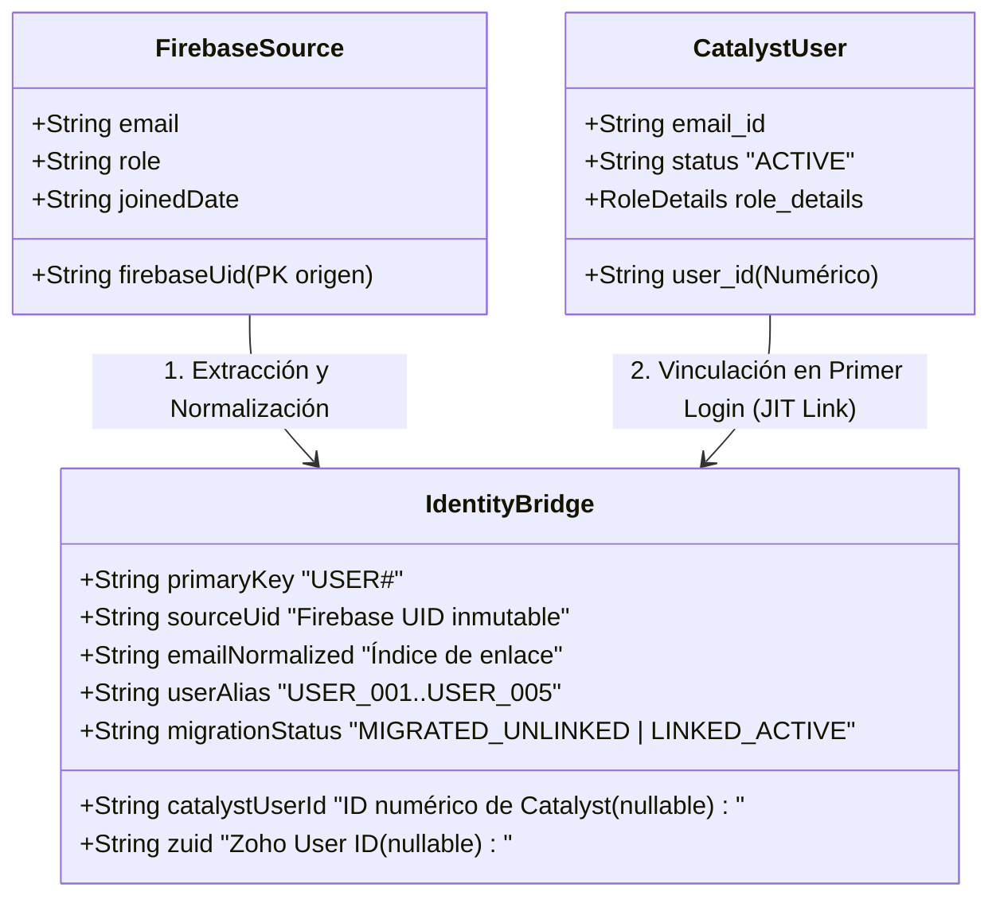

# VIGORCORE — DISEÑO DE MAPEO DE IDENTIDADES Y RELACIONES (FASE 3.4)
## Preservación de Históricos, Aislamiento Multi-inquilino y Estrategia de Vinculación

**Fecha de emisión:** 9 de noviembre de 2026  
**Auditor:** Arquitecto de Identidad, Seguridad y Sistemas Distribuidos  
**Alcance:** Coexistencia de identidades Google Firebase Auth y Zoho Catalyst Authentication para los 5 usuarios inventariados y sus 68 documentos descendientes.

---

## 1. EL DILEMA DE LA IDENTIDAD: FIREBASE UID VS CATALYST USER ID

En la arquitectura actual de Cloud Firestore:
- Los 5 usuarios están identificados por su **Firebase UID** (cadena alfanumérica de 28 caracteres, ej: `usr_ABC1234567890abcdefghijklmn`).
- Todos los documentos hijos en subcolecciones (`biometrics`, `groceries`, `workoutSessions`, etc.) se alojan bajo rutas jerárquicas `/users/{firebaseUid}/...` y en muchos casos contienen un campo interno redundante `userId: firebaseUid`.

En Zoho Catalyst:
- El servicio de autenticación nativo `@zcatalyst/auth` gestiona identidades mediante:
  - `user_id`: Identificador numérico largo único asignado por Catalyst (ej: `1583000000123456`).
  - `zuid`: Identificador global de cuenta Zoho (Zoho User ID).
  - `email_id`: Dirección de correo electrónico verificada del usuario.

### Principio de Diseño Fundamental [VERIFIED]:
**NO reemplazar el Firebase UID por el ID numérico de Catalyst en caliente ni descartarlo.**  
Hacerlo destruiría la trazabilidad histórica de los entrenamientos y sesiones registradas, y provocaría colisiones si el usuario aún no ha iniciado sesión en Catalyst.

---

## 2. ARQUITECTURA DEL MAPEO DE IDENTIDAD (TABLA DE CORRESPONDENCIA)

Se establece una estructura de correspondencia de doble vía (Cross-Reference Identity Bridge) almacenada en la tabla `Users`:



### Atributos del Registro de Identidad:
```typescript
export interface UserIdentityMapping {
  pk: string;                  // 'USER#' + sourceUid
  sk: 'PROFILE';
  sourceUid: string;           // Firebase UID original inmutable (ej: 'usr_ABC123...')
  userAlias: string;           // 'USER_001' .. 'USER_005' para trazabilidad anónima
  emailNormalized: string;     // Correo electrónico en minúsculas y sin espacios
  catalystUserId?: string;     // ID numérico asignado por Catalyst tras el primer login
  zuid?: string;               // Zoho User ID
  linkStatus: 'MIGRATED_UNLINKED' | 'LINKED_ACTIVE';
  migratedAt: number;          // Timestamp epoch ms de la migración
  linkedAt?: number;           // Timestamp epoch ms del primer enlace con Catalyst
}
```

---

## 3. MECANISMO DE VINCULACIÓN EN EL PRIMER ACCESO (JUST-IN-TIME IDENTITY LINKING)

Para los 5 usuarios históricos, la transición de autenticación funciona sin fricción y con máxima seguridad:

1. **Pre-aprovisionamiento (Durante la Fase ETL):**
   - El pipeline ETL crea el registro en la tabla `Users` con `pk = USER#<firebaseUid>`, `sourceUid = <firebaseUid>` y `linkStatus = 'MIGRATED_UNLINKED'`.
   - Se crea el índice secundario global `GSI_Email` sobre `emailNormalized`.
   - Todos los 68 documentos hijos se cargan en la tabla `UserData` con `pk = USER#<firebaseUid>`.
2. **Primer Acceso del Atleta a Zoho Catalyst:**
   - El atleta inicia sesión en Catalyst Slate mediante autenticación por correo o enlace mágico.
   - El middleware backend `authGuard` captura el `req.currentUser` de Catalyst (`user_id`, `email_id`).
   - El sistema ejecuta una búsqueda rápida en `Users` a través del índice `GSI_Email` con `emailNormalized = req.currentUser.email_id.toLowerCase()`.
   - *Hallazgo Positivo:* Encuentra el registro histórico pre-aprovisionado.
   - *Transición Atómica:* Se ejecuta una actualización condicional:
     ```typescript
     updateItems('Users', {
       keys: { pk: 'USER#' + found.sourceUid, sk: 'PROFILE' },
       update_attributes: [
         { operation_type: PUT, attribute_path: ['catalystUserId'], update_value: { S: req.currentUser.user_id } },
         { operation_type: PUT, attribute_path: ['zuid'], update_value: { S: req.currentUser.zuid } },
         { operation_type: PUT, attribute_path: ['linkStatus'], update_value: { S: 'LINKED_ACTIVE' } },
         { operation_type: PUT, attribute_path: ['linkedAt'], update_value: { N: String(Date.now()) } }
       ],
       condition: { attribute: ['linkStatus'], operator: EQUALS, value: { S: 'MIGRATED_UNLINKED' } }
     });
     ```
   - El token de sesión del usuario en Catalyst almacena internamente la referencia `sourceUid`.
   - El frontend continúa accediendo a los datos del atleta utilizando la clave `USER#<sourceUid>`, garantizando continuidad total sin renombrar 68 registros en `UserData`.

---

## 4. PREVENCIÓN DE CONTAMINACIÓN Y SUPLANTACIÓN MULTI-INQUILINO

Para garantizar matemáticamente que ningún usuario pueda acceder a los datos de otro ni suplantar identidades [VERIFIED]:

1. **Partición Estricta por Clave Primaria:**
   - En Zoho Catalyst NoSQL, todas las operaciones sobre `UserData` exigen explícitamente la clave de partición (`pk`).
   - El middleware del backend infiere el `pk` **exclusivamente** desde el contexto de identidad validado del token de Catalyst:
     ```typescript
     const actor = getAuthenticatedActor(req);
     const userPartitionKey = `USER#${actor.sourceUid}`;
     ```
   - El cliente frontend nunca tiene la capacidad de enviar un parámetro `targetUserId` arbitrario para leer datos personales en rutas no administrativas.
2. **Validación de Propiedad de Payload en Inserción:**
   - Antes de escribir cualquier registro en `UserData`, se comprueba que el campo interno `userId` del objeto coincida estrictamente con `actor.sourceUid`.

---

## 5. RECONCILIACIÓN DE IDENTIFICADORES Y RELACIONES INTERNAS

En los 73 documentos existen referencias cruzadas entre entidades que deben mantenerse intactas:

### A. Series de Gimnasio (`workoutSessions`) y Sesiones Ejecutadas (`executedWorkouts`)
- **Situación en Origen:**  
  Los 3 documentos en `workoutSessions` (USER_004: 1, USER_005: 2) y las 2 sesiones en `executedWorkouts` (USER_002: 2) se relacionan mediante el campo `executedWorkoutId`.
- **Estrategia:**  
  El ID del documento de Firestore (ej. `w_1730000000_abc`) se preserva exactamente como identificador del registro en Catalyst:
  - Sesión: `pk = USER#<uid>`, `sk = WORKOUT#<startedAt>#<id>`.
  - Serie: `pk = USER#<uid>`, `sk = SET#<executedWorkoutId>#<id>`.
  - El campo interno `executedWorkoutId` permanece inmutable.
- **Validación:**  
  La etapa de reconciliación comprueba que para cada serie con `executedWorkoutId`, la sesión exista o haya sido registrada bajo el mismo usuario.

### B. Despensa (`groceries`) y Menú Semanal (`mealPlans`) / Catálogo (`foodId`)
- **Situación en Origen:**  
  43 ítems en `groceries` poseen identificadores propios y campos opcionales `foodId` y `planKey`.
- **Estrategia:**  
  Se preserva el `id` original del documento en la clave de ordenamiento `sk = GROCERY#<id>`. Si el ítem fue generado por un plan, `planKey` mantiene su valor para evitar duplicación en re-agregaciones automáticas.

### C. Alimentos de Comidas (`mealLogs`) y Catálogo Nutricional
- **Situación en Origen:**  
  Los 4 registros de comidas contienen totales de calorías/macros y opcionalmente `foodId` / `foodFdcId`.
- **Estrategia:**  
  Se preserva el `mealLogId` en `sk = MEAL#<dateTime>#<id>`. Los datos nutricionales se transfieren de forma autosuficiente sin requerir joins en tiempo de lectura.

---

## 6. POLÍTICA DE ALIAS DETERMINISTAS Y PRIVACIDAD ZERO DATA

Para la confección de informes técnicos, auditorías y logs sin vulnerar la confidencialidad de los atletas [VERIFIED]:

| Alias Canónico | Origen Firestore | Cobertura en BD | Perfil Detectado |
| :---: | :---: | :---: | :--- |
| **USER_001** | Primer UID ordenado alfabéticamente | 2 documentos | Atleta registrado con onboarding (Biometría + Preferencias) |
| **USER_002** | Segundo UID ordenado alfabéticamente | 26 documentos | Atleta de alta actividad (Despensa: 21, Sesiones: 2, Notif: 1) |
| **USER_003** | Tercer UID ordenado alfabéticamente | 2 documentos | Atleta registrado con onboarding (Biometría + Preferencias) |
| **USER_004** | Cuarto UID ordenado alfabéticamente | 11 documentos | Atleta con actividad completa (Despensa: 1, Comidas: 3, Notif: 4, Serie: 1) |
| **USER_005** | Quinto UID ordenado alfabéticamente | 27 documentos | Atleta de máxima actividad (Despensa: 21, Comida: 1, Notif: 1, Series: 2) |

**Regla Estricta:** La tabla de correspondencia entre los Firebase UIDs reales y los alias `USER_001` .. `USER_005` reside exclusivamente en el archivo local `.data/manifests/identity-alias-map.json`, el cual está **rigurosamente excluido** del repositorio por `.gitignore`.
