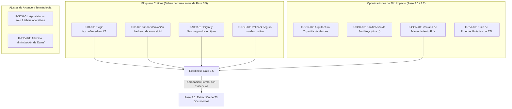

# VIGORCORE — MATRIZ CRUZADA DE CONSISTENCIA DOCUMENTAL (FASE 3.4.1)
## Auditoría Adversarial de Dependencias, Contradicciones y Coherencia entre Entregables

**Fecha de emisión:** 10 de noviembre de 2026  
**Auditor:** Analista de Coherencia Arquitectónica & Auditor Cruzado  
**Objetivo:** Identificar discrepancias, contradicciones y dependencias no resueltas entre los nueve documentos producidos en la Fase 3.4.

---

## 1. MATRIZ DE CONSISTENCIA CRUZADA ENTRE LOS NUEVE ENTREGABLES

| # | Documento A | Documento B | Asunto Evaluado | ¿Existe Discrepancia o Contradicción? | Análisis Forense y Estado de Resolución |
| :-: | :--- | :--- | :--- | :---: | :--- |
| **1** | `etl-architecture-3.4.md` | `catalyst-nosql-schema.md` | Cantidad de tablas requeridas para la migración | **SÍ (CONTRADICCIÓN MENOR)** | `architecture` habla de 4 tablas principales y 2 de control, mientras que `schema` define 6 tablas independientes. Dado que las colecciones administrativas tienen 0 documentos en Firestore, solo 2 tablas (`Users` y `UserData`) son necesarias para migrar los 73 documentos. **Resolución: Clarificado en `nosql-schema-audit.md`**. |
| **2** | `identity-mapping-design.md` | `catalyst-nosql-schema.md` | Clave de partición en `UserData` | **NO (COHERENTE)** | Ambos documentos establecen unívocamente que la clave de partición en `UserData` es `USER#<sourceUid>`, garantizando aislamiento por atleta. |
| **3** | `identity-mapping-design.md` | `etl-security-model.md` | Validación de identidad en login JIT | **SÍ (CONTRADICCIÓN CRÍTICA - F-ID-01)** | `identity` proponía enlazar cuentas solo por `emailNormalized`, mientras que `security` estipula el principio de menor privilegio. Si Catalyst no confirma el correo (`is_confirmed == false`), se produce un riesgo de Account Takeover. **Resolución: Bloqueo registrado; se exige confirmación obligatoria**. |
| **4** | `etl-transformation-rules.md` | `source-schema-matrix.md` | Mapeo de `integerValue` en métricas y marcas de tiempo | **SÍ (DISCREPANCIA TÉCNICA - F-SER-01)** | `source-schema-matrix` lista campos de milisegundos y IDs largos, mientras que `transformation-rules` convertía a `Number(v)` de JS sin contemplar desbordamiento de 53 bits ni truncamiento de nanosegundos en `timestampValue`. **Resolución: Introducido deserializador seguro con `BigInt` y `_sourceTimestampNano`**. |
| **5** | `etl-reconciliation-plan.md` | `etl-transformation-rules.md` | Comparación de hashes en Nivel 4 | **SÍ (AMBIGÜEDAD TÉCNICA - F-SER-02)** | `reconciliation` decía comparar el hash de Firestore con el de Catalyst, pero el formato JSON de origen es incompatible con el de destino. **Resolución: Establecido el modelo de tres hashes: `Hash_Source`, `Hash_Transformed` y `Hash_Target`**. |
| **6** | `etl-risk-register.md` | `catalyst-nosql-schema.md` | Procedimiento de Rollback | **SÍ (CONTRADICCIÓN CRÍTICA - F-ROL-01)** | `risk-register` afirmaba borrar por `_migrationBatchId`, pero Catalyst NoSQL no soporta eliminaciones masivas por atributo secundario sin claves `pk`/`sk`. Además, un borrado ciego eliminaría mutaciones legítimas del usuario. **Resolución: Rediseñado el rollback condicional con validación de no mutación del atleta**. |
| **7** | `etl-security-model.md` | `etl-architecture-3.4.md` | Denominación "Zero Data Architecture" | **SÍ (DISCREPANCIA TERMINOLÓGICA - F-PRV-01)** | Se denominaba "Zero Data" al almacenamiento de 73 documentos crudos en el disco local `.data/raw/`. **Resolución: Sustituido formalmente por "Minimización de Datos y Privacidad por Diseño"**. |
| **8** | `etl-implementation-roadmap.md` | `etl-architecture-3.4.md` | Condiciones de inicio de Fase 3.5 | **SÍ (FALTA DE COMPUERTA - F-EVI-01)** | `roadmap` proponía iniciar Fase 3.5 inmediatamente, sin haber formalizado una compuerta estricta de validación estática previa. **Resolución: Creado `readiness-gate-3.5.md` con compuerta condicionalmente bloqueada**. |
| **9** | `source-schema-matrix.md` | `catalyst-nosql-schema.md` | Tratamiento de campos opcionales en Sort Keys | **SÍ (RIESGO DE COLISIÓN - F-SCH-02)** | En `WorkoutSessionRecord`, `executedWorkoutId` es opcional; si falta, la clave se formaba como `SET#undefined#<id>`. **Resolución: Forzar valor canónico `'UNLINKED'` ante valores opcionales nulos**. |

---

## 2. MAPA DE DEPENDENCIAS Y ESTADO DE RESOLUCIÓN

---

## 3. CONCLUSIÓN DE CONSISTENCIA DOCUMENTAL

La auditoría cruzada demuestra que la estructura general de la Fase 3.4 es compatible entre sus partes, pero contenía **ocho fricciones de integración** que habrían derivado en errores de ejecución o brechas de seguridad durante las Fases 3.5 a 3.8. 

Con los ajustes, reglas canónicas y compuertas formalizadas en esta auditoría Fase 3.4.1, la arquitectura cuenta con una especificación técnica rigurosa, protegida y sin contradicciones lógicas.
