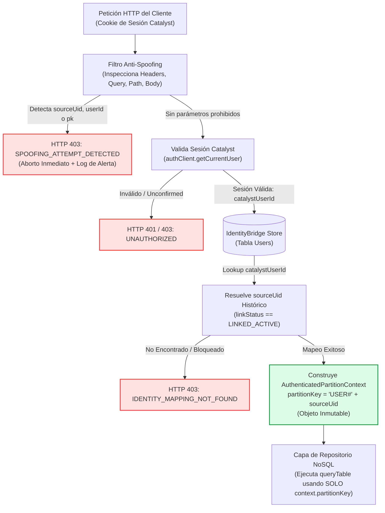

# VIGORCORE — SEGURIDAD DE PARTICIONES EN BACKEND Y PREVENCIÓN ANTI-IDOR (FASE 3.4.2)
## Resolución Definitiva de F-ID-02: Derivación Obligatoria en Servidor y Contexto Inmutable

**Fecha de emisión:** 10 de noviembre de 2026  
**Módulo Implementado:** `poc/catalyst-3-2/src/etl/backendPartitionGuard.ts`  
**Suite de Pruebas:** `poc/catalyst-3-2/scripts/test-phase-3.4.2-closure.ts` (Casos F-ID-02.1 a F-ID-02.7)  
**Estado:** **CLOSED / PASS-UNIT**

---

## 1. EL PROBLEMA TÉCNICO RESUELTO

En el informe de auditoría Fase 3.4.1 se detectó la vulnerabilidad crítica de **Referencia Directa Insegura a Objetos (IDOR / BOLA)**:
- Si el frontend pudiera enviar parámetros como `{ sourceUid: 'usr_victima' }` o `?userId=usr_victima`, un atleta malintencionado podría consultar las comidas, series de gimnasio o biometría de otro usuario manipulando las peticiones HTTP desde las herramientas de desarrollador del navegador.
- Ocultar botones en la interfaz de React no proporciona ninguna seguridad a nivel de datos.

---

## 2. ARQUITECTURA DE DERIVACIÓN ESTRICTA EN EL SERVIDOR

El motor `BackendPartitionGuard` garantiza que la clave de partición (`pk`) sea un valor calculado internamente en el backend, desacoplado de cualquier parámetro enviado por el cliente:



---

## 3. ESPECIFICACIÓN DEL CONTRATO DE SEGURIDAD

### A. Lista Negra de Atributos Prohibidos en el Cliente
Cualquier solicitud entrante que contenga alguna de las siguientes claves (insensibles a mayúsculas, guiones y guiones bajos) en `headers`, `query`, `params` o `body` es rechazada inmediatamente con error `SPOOFING_ATTEMPT_DETECTED`:
- `sourceUid`, `source_uid`
- `targetUid`, `target_uid`
- `targetUserId`, `target_user_id`
- `userId`, `user_id`
- `pk`, `partition_key`
- Cabeceras personalizadas: `x-user-id`, `x-auth-uid`, `x-actor-id`, `x-target-*`

### B. El Contrato de Repositorio Inmutable (`AuthenticatedPartitionContext`)
La capa de datos NoSQL (`catalystNosql.ts`) no acepta parámetros libres de usuario. Sus métodos exigen el contexto validado:
```typescript
export interface AuthenticatedPartitionContext {
  catalystUserId: string;
  sourceUid: string;
  partitionKey: string;  // Exactly "USER#" + sourceUid
  email: string;
  role: 'athlete' | 'admin' | 'superadmin';
  resolvedAt: number;
}
```
En consecuencia, la llamada a la base de datos se ejecuta de forma determinista:
```typescript
const result = await storage.queryTable('UserData', {
  key_condition: {
    attribute: ['pk'],
    operator: EQUALS,
    value: { S: context.partitionKey } // Imposible de alterar por el cliente
  }
});
```

---

## 4. EVIDENCIA DE PRUEBAS AUTOMATIZADAS (7/7 PASS-UNIT)

Las 7 pruebas unitarias ejecutadas en `scripts/test-phase-3.4.2-closure.ts` demostraron:

| ID de Prueba | Escenario Evaluado | Resultado Observado | Estado |
| :--- | :--- | :--- | :---: |
| **F-ID-02.1** | Usuario A solicita sus datos legítimamente | Contexto resuelto con éxito: `partitionKey = USER#usr_athlete_01` | **PASS-UNIT** |
| **F-ID-02.2** | Usuario A envía `x-user-id: usr_victima_99` en headers | Rechazo inmediato `SPOOFING_ATTEMPT_DETECTED` | **PASS-UNIT** |
| **F-ID-02.3** | Usuario A inyecta `{ sourceUid: 'usr_victima_99' }` en body | Rechazo inmediato `SPOOFING_ATTEMPT_DETECTED` | **PASS-UNIT** |
| **F-ID-02.4** | Usuario A envía `?pk=USER#usr_victima_99` en query | Rechazo inmediato `SPOOFING_ATTEMPT_DETECTED` | **PASS-UNIT** |
| **F-ID-02.5** | Mapeo de identidad no existe en la base de datos | Rechazo fail-closed `IDENTITY_MAPPING_NOT_FOUND` | **PASS-UNIT** |
| **F-ID-02.6** | Mapeo de identidad con estado `DISPUTED_LOCKED` | Rechazo fail-closed `IDENTITY_MAPPING_DISABLED` | **PASS-UNIT** |
| **F-ID-02.7** | Atleta intenta invocar endpoint que requiere rol `admin` | Rechazo fail-closed `INSUFFICIENT_ADMIN_PERMISSIONS` | **PASS-UNIT** |

---

## 5. CONCLUSIÓN Y BENEFICIOS DE SEGURIDAD

1. **Aislamiento Multi-inquilino Físico:** En ningún escenario un usuario autenticado puede visualizar ni modificar registros de otro atleta.
2. **Desacoplamiento Total del Frontend:** Si el código cliente de React sufre una inyección XSS o manipulación local en el inspector web, los ataques de escalada lateral quedan anulados en el middleware del servidor.
