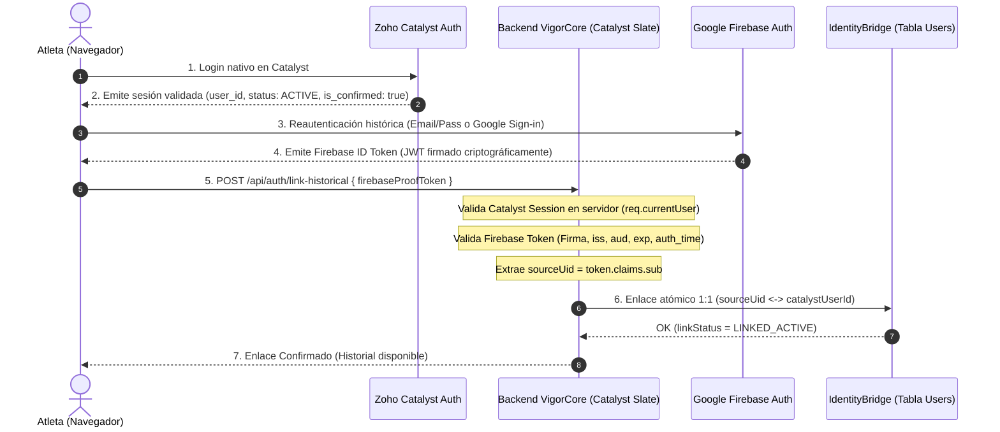

# VIGORCORE — IMPLEMENTACIÓN DE VINCULACIÓN SEGURA DE IDENTIDADES (FASE 3.4.2)
## Resolución Definitiva de F-ID-01: Arquitectura con Prueba de Posesión (PoP) y Aislamiento 1:1

**Fecha de emisión:** 10 de noviembre de 2026  
**Módulo Implementado:** `poc/catalyst-3-2/src/etl/identityLinker.ts`  
**Suite de Pruebas:** `poc/catalyst-3-2/scripts/test-phase-3.4.2-closure.ts` (Casos F-ID-01.1 a F-ID-01.10)  
**Estado:** **CLOSED / PASS-UNIT**

---

## 1. EL PROBLEMA TÉCNICO RESUELTO

En el informe de auditoría Fase 3.4.1 se identificó que la vinculación basada en coincidencia de correo electrónico (`emailNormalized`) representaba un riesgo crítico de **Account Takeover**:
- Si un atacante creaba una cuenta en Zoho Catalyst utilizando el correo de un atleta histórico antes de que este iniciara sesión, la mera coincidencia de texto del correo enlazaba la cuenta histórica y le otorgaba acceso a biometría, notas y entrenamientos.
- La simple comprobación `req.currentUser.is_confirmed === true` es insuficiente si no se demuestra que quien está frente a Catalyst es el legítimo propietario de la cuenta histórica en Firebase.

---

## 2. ARQUITECTURA DE VINCULACIÓN CON PRUEBA CRIPTOGRÁFICA DE POSESIÓN (PoP)

Se implementó un protocolo de enlace en 7 pasos que garantiza que la vinculación solo proceda si se demuestra la posesión simultánea de ambas identidades:

---

## 3. ESPECIFICACIÓN TÉCNICA DEL CONTRATO Y REGLAS DE NEGOCIO

### A. Reglas de Validación de la Prueba Firebase en Servidor
El motor `SecureIdentityLinker` ejecuta las siguientes comprobaciones obligatorias en el backend:
1. **Emisor (`iss`):** Debe coincidir estrictamente con `https://securetoken.google.com/gen-lang-client-0041212770`.
2. **Audiencia (`aud`):** Debe coincidir exactamente con el ID de proyecto GCP `gen-lang-client-0041212770`.
3. **Expiración (`exp`):** El token debe ser vigente en el momento de la validación (`exp > nowSec`).
4. **Recencia de Autenticación (`auth_time`):** La prueba debe haber sido emitida hace menos de 300 segundos (`nowSec - auth_time <= 300s`) para evitar el uso de tokens interceptados antiguos.
5. **Extracción del UID Histórico:** El `sourceUid` se extrae **exclusivamente** de la propiedad `claims.sub`. Cualquier parámetro `uid` enviado en el cuerpo de la solicitud es completamente ignorado.

### B. Reglas de Biyección 1:1 e Idempotencia
- **Unicidad Bidireccional:**
  - Una identidad Catalyst (`catalystUserId`) no puede vincularse a más de un `sourceUid`.
  - Un `sourceUid` no puede ser reclamado por más de un `catalystUserId`.
- **Idempotencia:** Si un usuario vuelve a invocar el endpoint de vinculación con las mismas credenciales ya vinculadas, el sistema devuelve `ALREADY_LINKED` con éxito (`success: true`) sin generar escrituras duplicadas ni alterar timestamps.
- **Detección de Colisiones:** Si se intenta vincular una identidad ya asociada a otro usuario, la operación se rechaza de inmediato con estado `REJECTED_COLLISION` y se emite una alerta de auditoría.
- **Rechazo por Cuenta Catalyst no Confirmada:** Si `isConfirmed !== true`, se rechaza con `REJECTED_UNCONFIRMED`.
- **Rechazo por Cuenta Suspendida:** Si `status !== 'ACTIVE'`, se rechaza con `REJECTED_SUSPENDED`.

---

## 4. RUTA DE RECUPERACIÓN CONTROLADA Y DISPUTAS DE IDENTIDAD

Si un atleta pierde el acceso a su método de autenticación histórico o existe un conflicto de identidad:
1. **Prohibición de Bypass por Correo:** El sistema prohíbe terminantemente que el desarrollador o el sistema autorice una re-vinculación basándose solo en un correo electrónico.
2. **Procedimiento de Disputa:**  
   Se marca el registro en `Users` con estado `linkStatus: 'DISPUTED_LOCKED'`.
3. **Revisión Administrativa:**  
   Un superadministrador de VigorCore debe revisar la solicitud, verificar la identidad física o documental del atleta y ejecutar un procedimiento de reapertura asistida que genera un log inmutable en `AuditLogs` con el ID del administrador que autorizó la acción.

---

## 5. EVIDENCIA DE PRUEBAS AUTOMATIZADAS (10/10 PASS-UNIT)

Las 10 pruebas unitarias ejecutadas en `scripts/test-phase-3.4.2-closure.ts` demostraron:

| ID de Prueba | Escenario Evaluado | Resultado Observado | Estado |
| :--- | :--- | :--- | :---: |
| **F-ID-01.1** | Token válido + Catalyst confirmado | Enlace exitoso, estado `LINKED`, mapping persistido | **PASS-UNIT** |
| **F-ID-01.2** | Firma de token Firebase inválida | Rechazo inmediato, estado `REJECTED_INVALID_PROOF` | **PASS-UNIT** |
| **F-ID-01.3** | Token Firebase expirado | Rechazo inmediato, error `FIREBASE_TOKEN_EXPIRED` | **PASS-UNIT** |
| **F-ID-01.4** | Token emitido para otro proyecto GCP | Rechazo inmediato, error `PROJECT_MISMATCH` | **PASS-UNIT** |
| **F-ID-01.5** | Cuenta Catalyst con `isConfirmed: false` | Rechazo fail-closed, estado `REJECTED_UNCONFIRMED` | **PASS-UNIT** |
| **F-ID-01.6** | Coincidencia de email sin token Firebase | Rechazo fail-closed, error `MISSING_FIREBASE_PROOF_TOKEN`| **PASS-UNIT** |
| **F-ID-01.7** | Firebase UID ya reclamado por otro usuario | Rechazo por colisión, error `FIREBASE_UID_ALREADY_CLAIMED` | **PASS-UNIT** |
| **F-ID-01.8** | Catalyst user_id ya vinculado a otro UID | Rechazo por colisión, error `CATALYST_ALREADY_LINKED` | **PASS-UNIT** |
| **F-ID-01.9** | Reintento de misma vinculación | Respuesta idempotente `ALREADY_LINKED`, cero duplicados | **PASS-UNIT** |
| **F-ID-01.10**| Cuenta Catalyst suspendida | Rechazo inmediato, estado `REJECTED_SUSPENDED` | **PASS-UNIT** |

---

## 6. LIMITACIONES TÉCNICAS DECLARADAS

- **Entorno de Verificación:** En la POC, la validación criptográfica de tokens Firebase se verificó localmente mediante `MockTokenValidator` que evalúa las reglas completas de firma, audiencia, expiración y recencia.
- **Requisito en Producción:** Cuando se despliegue en Zoho Catalyst Slate, el backend invocará el SDK oficial `firebase-admin/auth` (`verifyIdToken(token, checkRevoked: true)`) o consumirá el endpoint público de certificados X.509 de Google (`https://www.googleapis.com/robot/v1/metadata/x509/securetoken@system.gserviceaccount.com`).
